```{=html}
<!-- ===== HERO — Masthead (Fergusson) + photo/headline (Eslava) ===== -->
<section class="hero-c">
  <div class="hc-mast">
    <div class="hc-name" role="heading" aria-level="1"><span class="nm-first">Alexander</span> <span class="nm-last">Buriticá Casanova</span></div>
    <p class="hc-role">Postdoctoral Researcher<br>Alliance of Bioversity International and CIAT<br>CGIAR · Cali, Colombia</p>
  </div>

  <div class="hc-main">
    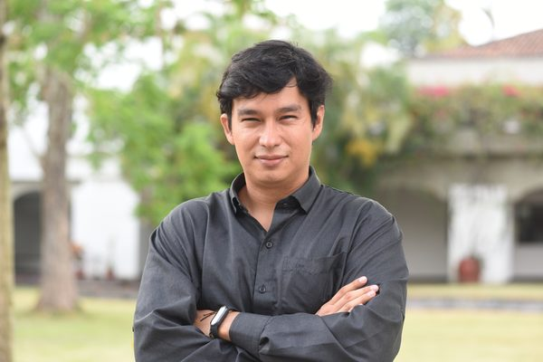
    <div class="hc-text">
      <div class="hc-bio">
        <p>I study the gap between technology access and welfare outcomes in agriculture, with a focus on impact evaluation, food security, and post-conflict rural development across Latin America and Sub-Saharan Africa.</p>
        <p>I am a Postdoctoral Researcher in Applied Economics and Impact Evaluation at the <a href="https://alliancebioversityciat.org/" target="_blank">Alliance of Bioversity International and CIAT</a> (<a href="https://www.cgiar.org/" target="_blank">CGIAR</a>), and hold a PhD in Economics from <a href="https://economia.uniandes.edu.co/" target="_blank">Universidad de los Andes</a>, Bogotá.</p>
        <p>My work has been published in journals including <a href="https://www.sciencedirect.com/journal/agricultural-systems" target="_blank">Agricultural Systems</a>, <a href="https://www.sciencedirect.com/journal/journal-of-rural-studies" target="_blank">Journal of Rural Studies</a>, and <a href="https://link.springer.com/journal/10640" target="_blank">Environmental and Resource Economics</a>, and I have contributed to multi-country research initiatives with CGIAR and international development organizations.</p>
      </div>

      <p class="hc-links">
        <a href="mailto:a.buritica@cgiar.org"><i class="fa-solid fa-envelope"></i>Email</a><span>·</span>
        <a href="https://scholar.google.com/citations?hl=es&user=43WzRV4AAAAJ&view_op=list_works&sortby=pubdate" target="_blank"><i class="ai ai-google-scholar"></i>Google Scholar</a><span>·</span>
        <a href="https://orcid.org/0000-0002-3856-9126" target="_blank"><i class="ai ai-orcid"></i>ORCID</a><span>·</span>
        <a href="https://github.com/AlexanderBuritica" target="_blank"><i class="fa-brands fa-github"></i>GitHub</a><span>·</span>
        <a href="https://www.linkedin.com/in/alexander-buritica-casanova-738827155/" target="_blank"><i class="fa-brands fa-linkedin"></i>LinkedIn</a><span>·</span>
        <a href="files/cv_ingles_v3.pdf" target="_blank"><i class="fa-solid fa-file-pdf"></i>CV</a>
      </p>
    </div>
  </div>
</section>

<!-- ===== FIELDWORK STRIP ===== -->
<div class="fw-strip">
  <a href="speakers.html" class="fw-strip-item">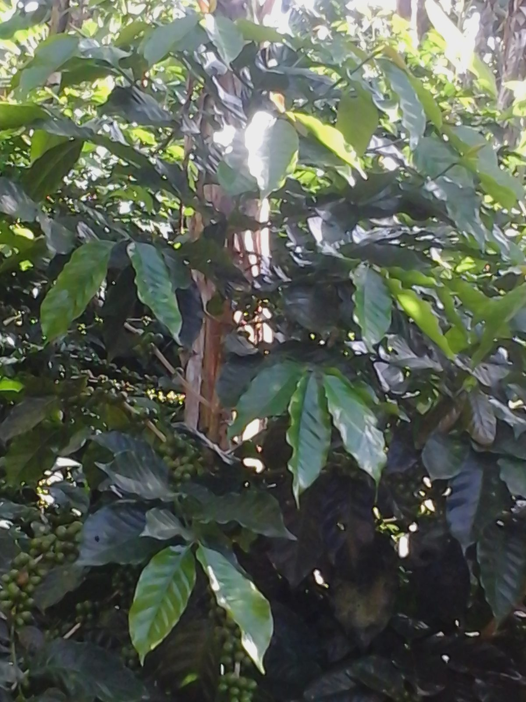</a>
  <a href="speakers.html" class="fw-strip-item">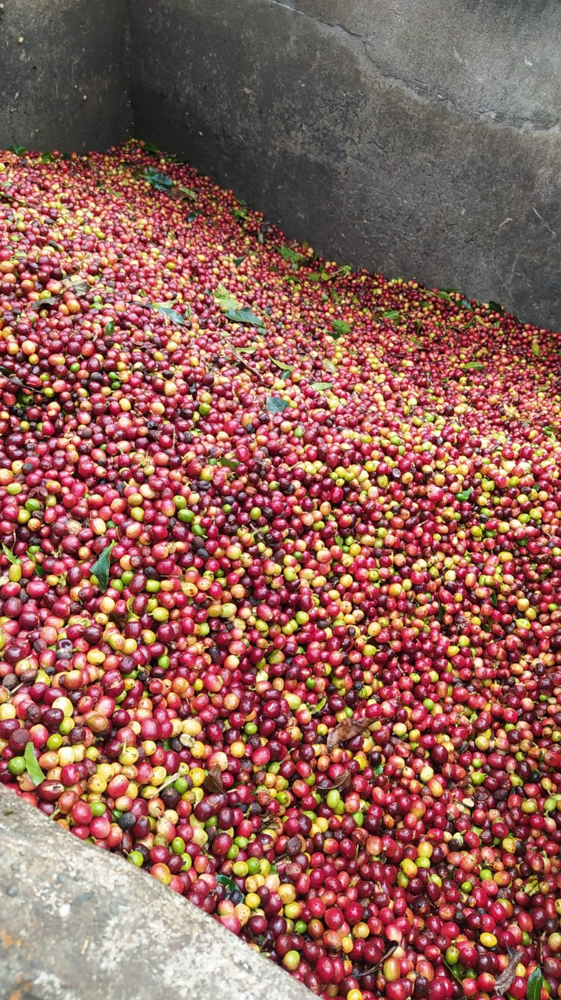</a>
  <a href="speakers.html" class="fw-strip-item">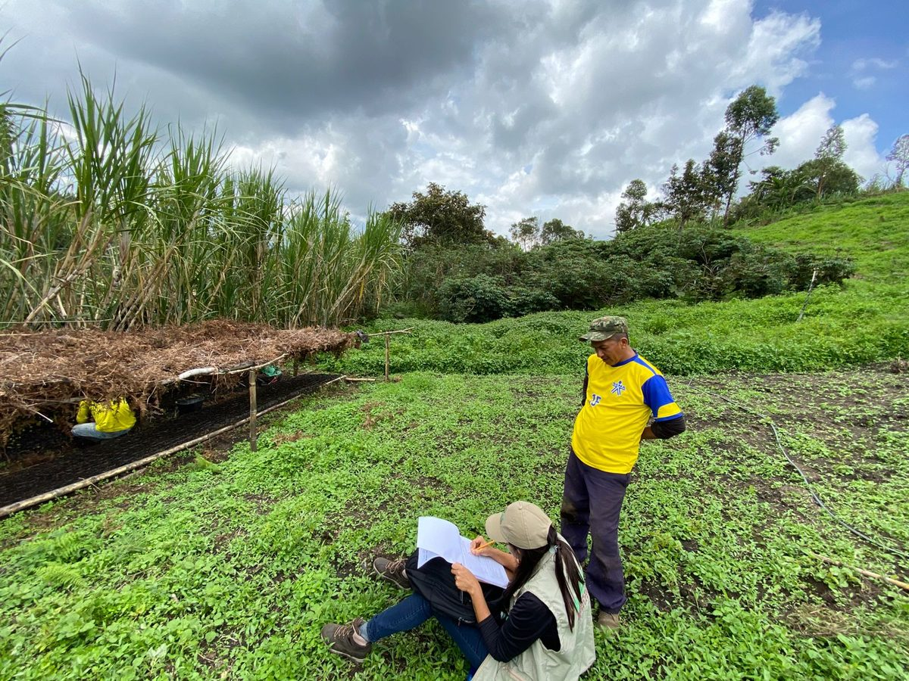</a>
  <a href="speakers.html" class="fw-strip-item">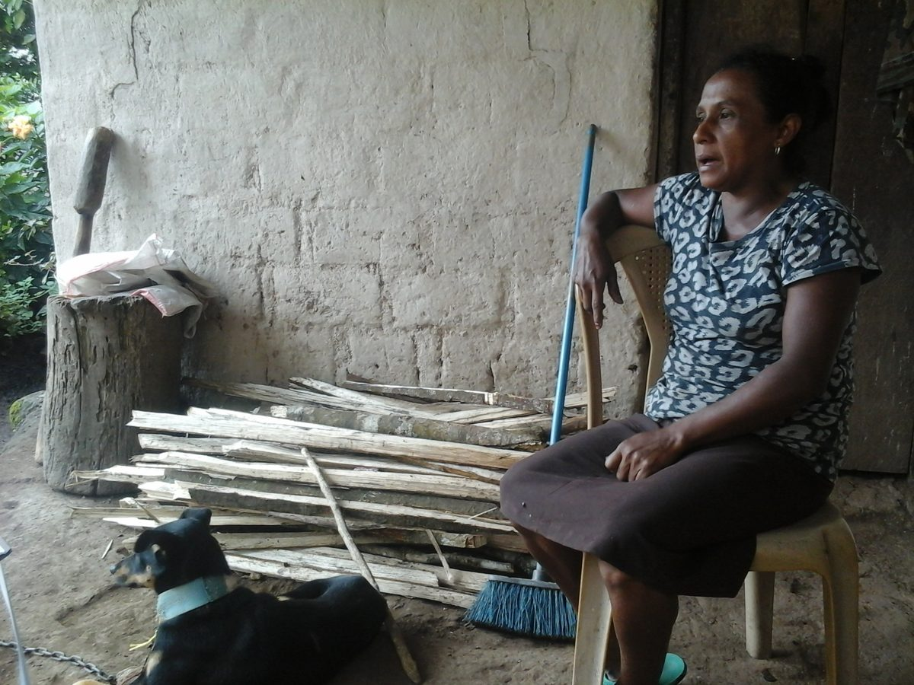</a>
  <a href="speakers.html" class="fw-strip-item">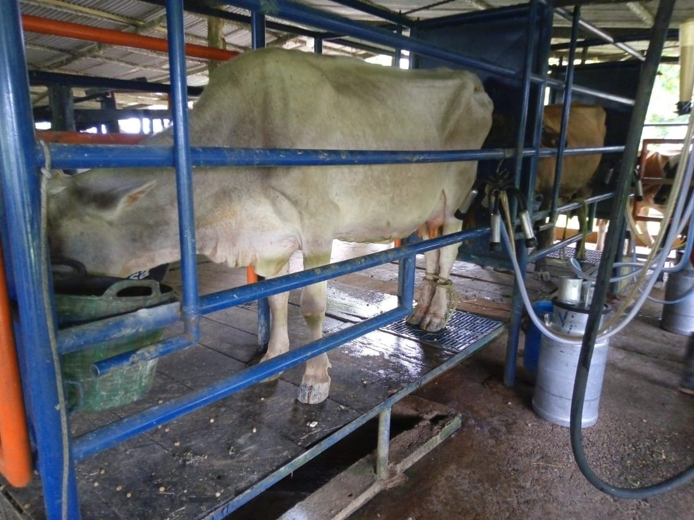</a>
  <div class="fw-strip-label"><span>Fieldwork</span></div>
</div>

<hr class="section-divider">

<!-- ===== EDUCATION ===== -->
<section class="home-section">
  <h2>Education</h2>
  <div class="cv-list">

    <div class="cv-item">
      <div class="cv-logo">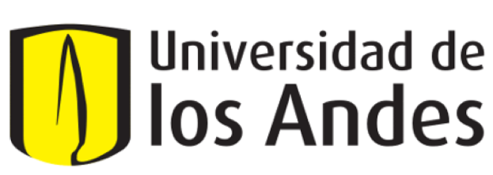</div>
      <div class="cv-body">
        <strong>PhD in Economics</strong> <span class="cv-date">(2016–2023)</span><br>
        Universidad de los Andes, Colombia
      </div>
    </div>

    <div class="cv-item">
      <div class="cv-logo"></div>
      <div class="cv-body">
        <strong>MSc in Economics</strong> <span class="cv-date">(2016–2023)</span><br>
        Universidad de los Andes, Colombia
      </div>
    </div>

    <div class="cv-item">
      <div class="cv-logo">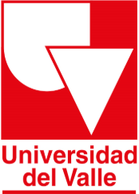</div>
      <div class="cv-body">
        <strong>BSc in Economics</strong> <span class="cv-date">(2007–2013)</span><br>
        Universidad del Valle, Colombia
      </div>
    </div>

  </div>
</section>

<hr class="section-divider">

<!-- ===== EXPERIENCE ===== -->
<section class="home-section">
  <h2>Experience</h2>
  <div class="cv-list">

    <div class="cv-item">
      <div class="cv-logo">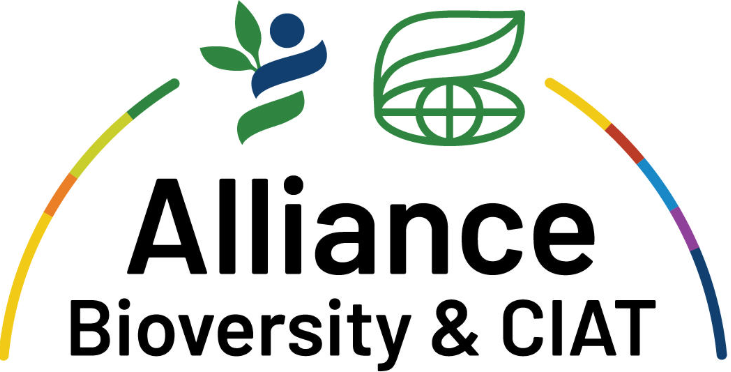</div>
      <div class="cv-body">
        <strong>Postdoctoral Fellow</strong> <span class="cv-date">(2023–Present)</span><br>
        Alliance of Bioversity International & CIAT (CGIAR)
      </div>
    </div>

    <div class="cv-item">
      <div class="cv-logo"></div>
      <div class="cv-body">
        <strong>Senior Research Associate</strong> <span class="cv-date">(2022–2023)</span><br>
        Alliance of Bioversity International & CIAT (CGIAR)
      </div>
    </div>

    <div class="cv-item">
      <div class="cv-logo">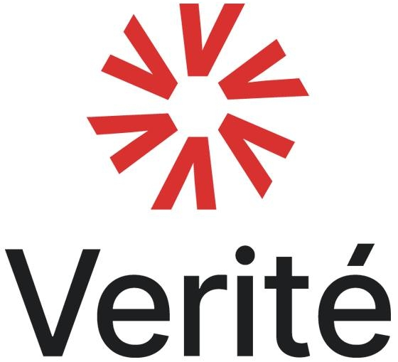</div>
      <div class="cv-body">
        <strong>Development Economics Specialist</strong> <span class="cv-date">(2021–2022)</span><br>
        Vérité · Amherst, USA
      </div>
    </div>

    <div class="cv-item">
      <div class="cv-logo"></div>
      <div class="cv-body">
        <strong>Visiting Researcher</strong> <span class="cv-date">(2019–2021)</span><br>
        CIAT · Palmira, Colombia
      </div>
    </div>

    <div class="cv-item">
      <div class="cv-logo"></div>
      <div class="cv-body">
        <strong>Research Assistant</strong> <span class="cv-date">(2013–2016)</span><br>
        CIAT · Palmira, Colombia
      </div>
    </div>

  </div>
</section>

<hr class="section-divider">

<!-- ===== AWARDS ===== -->
<section class="home-section">
  <h2>Awards & Fellowships</h2>
  <div class="cv-list">

    <div class="cv-item">
      <div class="cv-logo">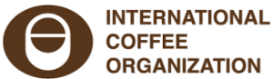</div>
      <div class="cv-body">
        <strong>ICO Award for Excellence in Coffee Research</strong> <span class="cv-date">(2019)</span><br>
        International Coffee Organization
      </div>
    </div>

    <div class="cv-item">
      <div class="cv-logo">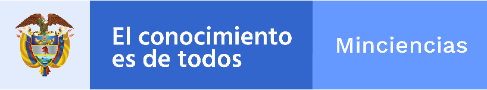</div>
      <div class="cv-body">
        <strong>COLCIENCIAS Doctoral Scholarship</strong> <span class="cv-date">(2017–2020)</span><br>
        Minciencias, Colombia
      </div>
    </div>

  </div>
</section>

<hr class="section-divider">

<!-- ===== SELECTED PUBLICATIONS ===== -->
<section class="home-section">
  <h2>Selected Publications</h2>

  <div class="selected-papers">

    <a href="https://www.sciencedirect.com/science/article/pii/S0306919215000810" target="_blank" class="feat-card">
      <span class="feat-year">2015</span>
      <div class="feat-img">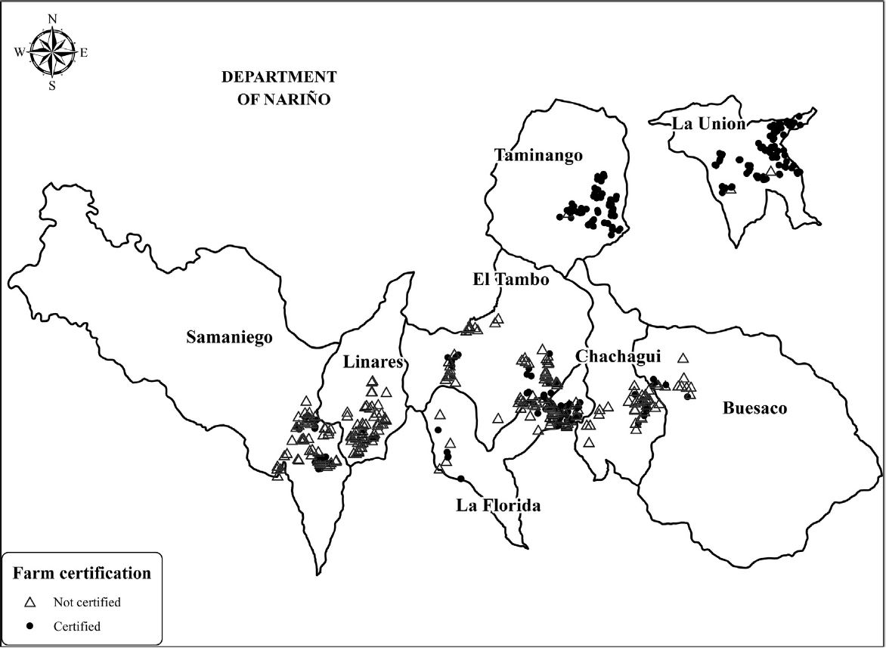</div>
      <div class="feat-body">
        <div class="feat-title">The effect of specialty coffee certification on household livelihood strategies and specialisation</div>
        <div class="feat-journal"><em>Food Policy</em>, 2015</div>
      </div>
    </a>

    <a href="https://doi.org/10.1016/j.jrurstud.2026.104167" target="_blank" class="feat-card">
      <span class="feat-new">NEW</span><span class="feat-year">2026</span>
      <div class="feat-img">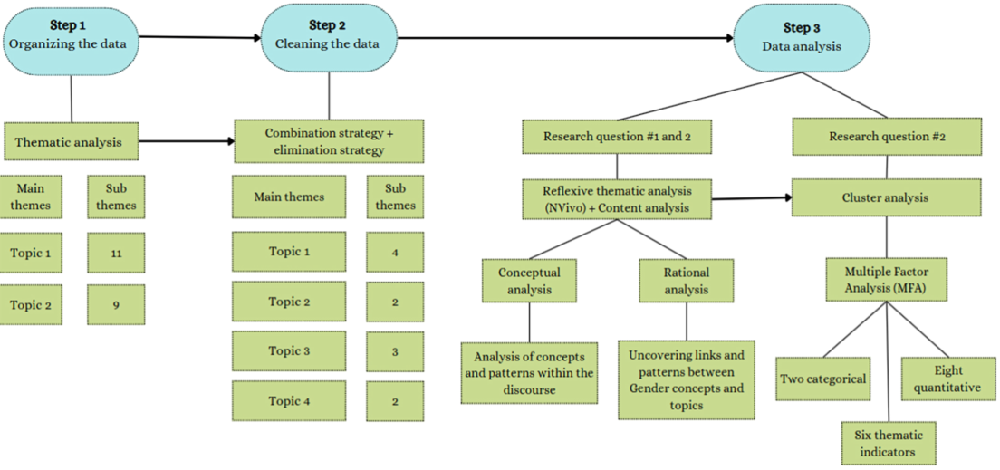</div>
      <div class="feat-body">
        <div class="feat-title">Rural women's voices and gender dynamics in Colombian land restitution policy</div>
        <div class="feat-journal"><em>Journal of Rural Studies</em>, 2026</div>
      </div>
    </a>

    <a href="https://doi.org/10.1016/j.agsy.2025.104525" target="_blank" class="feat-card">
      <span class="feat-new">NEW</span><span class="feat-year">2026</span>
      <div class="feat-img">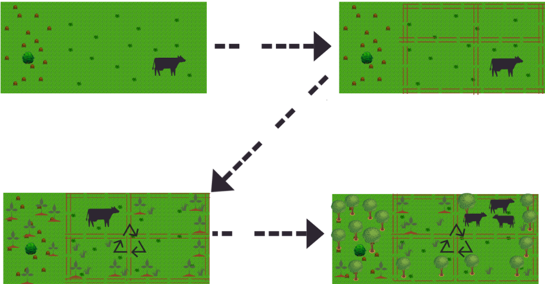</div>
      <div class="feat-body">
        <div class="feat-title">Advancing sustainable silvopastoral practices for achieving zero deforestation in the Colombian Amazon</div>
        <div class="feat-journal"><em>Agricultural Systems</em>, 2026</div>
      </div>
    </a>

  </div>

  <p class="selected-more">
    See all <a href="publications.html">publications & working papers</a> · <a href="news2.html">news & highlights</a>
  </p>
</section>
```
